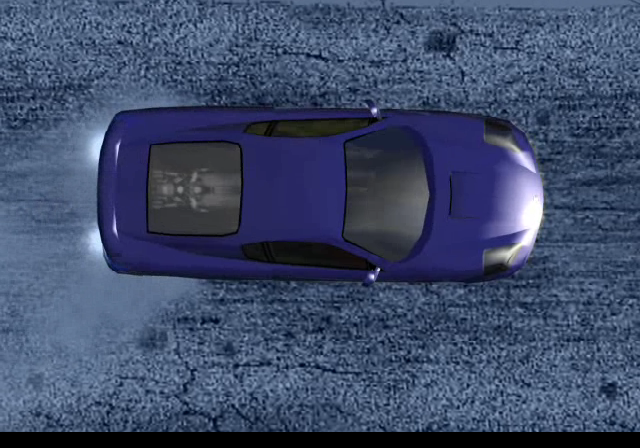
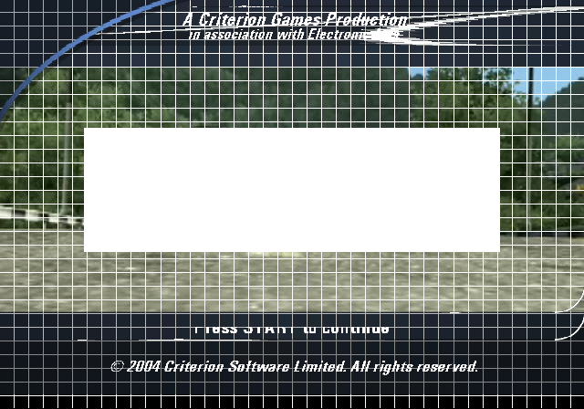

# Booting on the xboxrecomp runtime

How Burnout 3 gets from its XBE entry point to the "Press START" title screen
on the shared [xboxrecomp](https://github.com/sp00nznet/xboxrecomp) runtime,
with no hand-written game code. `src/game/main.c` brings up the hardware the
XBE expects and jumps to 0x001D2807. Every screen below is drawn by the title's
own recompiled D3D8LTCG through the runtime's NV2A pushbuffer executor.

The build follows `../hl2`. `regen.sh` drives the toolkit's pipeline, and
`config/seed_functions.json` holds the function entries that only a run can
find. The old in-tree runtime fork under `src/{kernel,d3d,audio,input,apu,
nv2a,platform}` is no longer built.





## Running it

```
./regen.sh --disasm                        # disasm + func_id + abi + recomp
cmake -S . -B build-xr -DBO3_COMPILE_JOBS=3
cmake --build build-xr --config Release --target burnout3
RECOMP_PB_EXEC=1 RECOMP_FB_DUMP=frame ./bin/burnout3.exe   # frame000.bmp ...
```

It runs headless by default, and the runtime opens a window only when
`RECOMP_FB_WINDOW` is set. Without `RECOMP_PB_EXEC` nothing is rasterised, but
the title runs about 50x faster, which is the quicker way to follow the boot
by its file accesses. `saves/` holds the emulated HDD partition images; delete
it for a first-boot run.

## What stood between the entry point and the title screen

In order. Each fix is either a runtime or toolkit change, which goes upstream,
or per-title data in `main.c`.

| # | Symptom | Cause | Fix |
|---|---|---|---|
| 1 | Fault in `xbox_MemoryLayoutInit` reading guest 0x80001000; "contiguous window failed (error 487)" | Windows cannot release part of a reservation. The RAM-mirror span leaked 1.8 GB at host 0x80000000. HL2 never saw it because its 768 MB map puts the span above 4 GB. | toolkit `fix/span-reservation-leak` |
| 2 | XAPI quick-reboots (`HalReturnToFirmware(2)`) right after start | `saves\` did not exist, so `Partition1.img` could not be created | create `saves/` |
| 3 | Spin in `sub_00351770` | D3D8LTCG waits on the GPU fence: device pointer at 0x0035FB48, `+0x2C` submitted, `*(+0x30)` consumed | `xbox_Nv2aMirrorFence(0x0035FB48, 0x2C, 0x30)` |
| 4 | Fault in `sub_001FD770`, reading guest 0xFFFFFFEC | RenderWare's audio device is created during engine start. `sub_0020A540` calls `DirectSoundCreate` (0x002F7432), which failed, and the NULL device went on to the pipeline builder. | `RECOMP_AC97_READY=1` plus APU MMIO routing in the fault handler |
| 5 | Spin at 0x002F8029 | DirectSound writes 3 to a DSP command word and waits for the DSP to clear it. There is no DSP56300 here. | `RECOMP_APU_DSP_ACK=0x825F8810`, observed as `ebx+0x810` in the spin |
| 6 | Unrecoverable fault in the host `memcpy` reading 0xFE830B78 | The whole APU aperture was trapped, but GP/EP DSP memory is plain RAM on hardware, and the MMIO decoder cannot emulate a lowered `rep movsd` | toolkit `fix/apu-dsp-memory-untrapped` |
| 7 | XAPI takes the dashboard-update path (`C:\xboxdash.xbe`, then launches `dashupdate.xbe`) | Two memcpy jump-table arms had been seeded as functions. That split `memcpy`, an indirect call during XAPI init went unresolved, and heap creation was skipped. | dropped the bad seeds; toolkit `fix/switch-table-offset-index` |
| 8 | Stall in `sub_002F805E` with the executor on | The doorbell ack only ran inside `se_frame`, which is gated off while the APU front end is trapped | toolkit `fix/apu-doorbell-ungated` |
| 9 | Intro movie holds on its first frame | The XMV player paces on `[device+0x1DE8]`, which only D3D's vblank handler (`sub_00350EC0`) increments | `xbox_Nv2aFrameCounter(0x0035FB48, 0x1DE8)` |

Numbers 4 and 9 are what the HL2 loader needed, and 5 is the Wreckless
doorbell, which also sits at offset 0x...F8810. What changes from title to
title is the address, not the mechanism.

### Seeds are measurements, and some of them are wrong

`tools.seed_from_log` feeds indirect-call targets that a run reached back into
the disassembler. It accepted 0x00244404 and 0x00244544 as "aliases" inside
`sub_002442A0`. That function is the CRT `memcpy`, and both addresses are arms
of its internal jump tables, reached through `jmp [reg*4+table]` dispatches
that the lifter had emitted as indirect tail jumps. Seeding the first one ended
`memcpy` at 0x00244403, so its main table's arms fell outside the function and
another dispatch went unresolved. The fix belongs in the lifter, which now
lifts those tables as local switches (#7). A seed the tool marks as an alias
should be checked against the function it lands in before it is kept.

## Where it stands

Boot sequence, all from the title's own code:

```
ovid\englis30.xmv    EA intro
ovid\cri_rw30.xmv    Criterion intro
ovid\Titles30.xmv    title sequence
tracks\_femain.rws + tracks\_FEMain.xmv   "Press START to continue", attract video behind it
```

It idles there. Six minutes at the title screen loaded nothing further. The
Burnout 3 logo draws as a white box because the software rasteriser does not
decode that texture's format yet.
